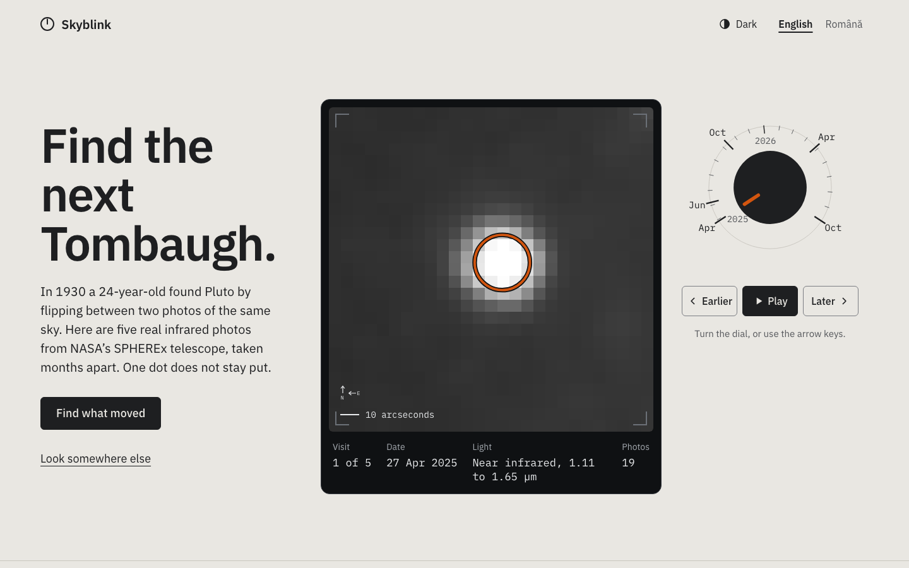
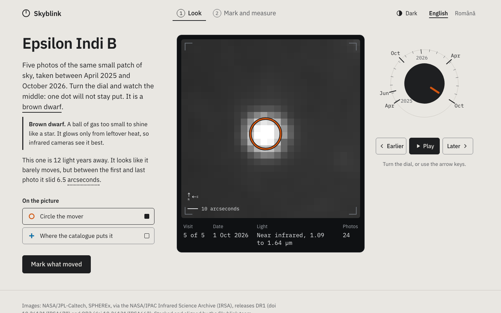
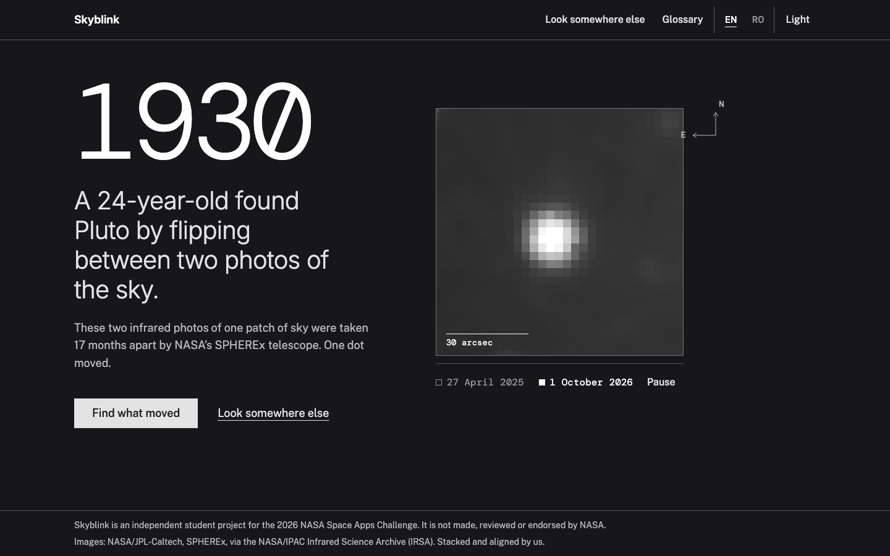
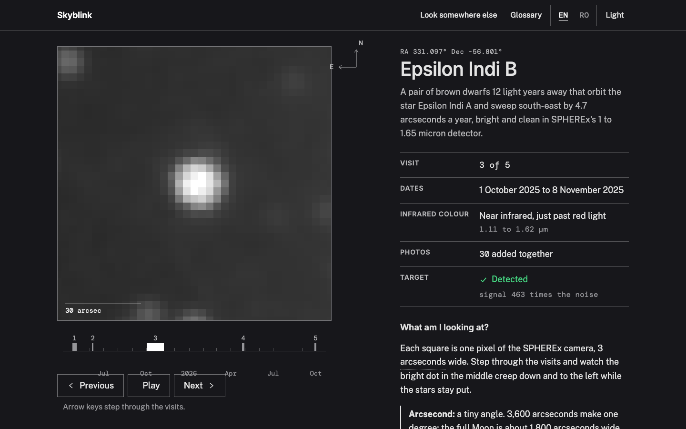

# Raport complet: ce s-a făcut, cum, ce merge și ce mai trebuie

Scris sâmbătă, 14 noiembrie 2026, în jurul orei 19:30 (ora României), la oprirea sesiunii de lucru de pe laptop. Termenul de predare este duminică, 15 noiembrie, 23:59. Ținta internă a echipei: duminică, 17:00.

Raportul descrie starea de la oprire. Tot ce scrie aici ca „verificat" a fost rulat din nou de cel care a coordonat lucrul, nu doar raportat de cel care a scris codul. Unde nu s-a verificat, scrie.

Documente înrudite (citește-le în ordinea asta):

1. `docs/ECHIPA-START-AICI.md`: cum pornești proiectul pe calculatorul tău, pas cu pas.
2. Raportul de față: starea și ce urmează.
3. `docs/SUBMISSION-CHECKLIST.md`: fiecare câmp din formularul de predare și starea lui.
4. `docs/ARCHITECTURE.md`, `docs/DATA.md`, `docs/DEPENDENCIES.md`: cum e construit, de unde vin datele, ce biblioteci folosim.
5. `docs/PROCESS.md`: cum s-a lucrat, cu ce unelte, cum a fost folosit AI.
6. `docs/plans/RUN-spherex-24h.md`: planul pe 24 de ore.
7. `docs/RESEARCH-INDEX.md` și `docs/research/`: cele 15 note de cercetare.

## 0. Pe scurt

**Ce există și merge (verificat):**

- Datele pentru cele cinci ținte ale provocării (Epsilon Indi B, steaua lui Barnard, WISE 0855, RW Aurigae, R Draconis), gata de redat, în `assets/missions/`.
- O bibliotecă TypeScript care citește imaginile SPHEREx direct din depozitul public al NASA, în browser, pentru orice coordonată (`packages/spherex-core`, 55 de teste).
- O bibliotecă TypeScript cu toată matematica de măsurare: mișcare proprie, paralaxă, distanță, viteză, scor, raport într-un link (`packages/missions-core`, 32 de teste).
- Aplicația web v1 (`web/`): pagina de start și pagina `/watch`, care redă cele cinci ținte ca un film, cu marcaje, cu verificarea „s-a mutat" și cu starea păstrată în adresă (60 de teste, compilare curată, build reușit).
- Unealta care randează videoclipul de 30 de secunde din scene HTML (`video/`), cu începutul și sfârșitul gata.
- Documentația și 15 note de cercetare.

**Ce NU există încă în aplicație:**

- Orice coordonată tastată de utilizator (inima provocării). Biblioteca e gata și testată pe date reale; legarea ei în aplicație nu a fost începută. Vezi secțiunea 3.1.
- Misiunile de măsurare (partea educațională). Biblioteca e gata; ecranele nu au fost începute. Vezi secțiunea 3.2.
- Noul design. Aspectul v1 a fost respins de șeful de echipă („foarte vibe codat"). Există trei machete din care se alege una. Vezi secțiunea 3.4.
- Indexul static al expunerilor. Codul e scris și testat pe date sintetice, dar are zero date reale: arhiva IRSA a răspuns HTTP 502 tot intervalul. Vezi secțiunea 3.3.
- Publicarea pe internet (deploy), filmul final cu imagini din aplicație, formularul de predare.

**Primul lucru de făcut când reluați:** alegeți direcția de design (secțiunea 3.4), apoi terminați calea live și misiunea 1, în ordinea din secțiunea 4.

## 1. Unde e fiecare lucru

Depozitul echipei: `https://github.com/mirunazh/Planet-X-SPHEREx-NASA` (public).

| Ramură | Ce conține | Stare |
|---|---|---|
| `main` | Aplicația Next de dinainte a echipei (globul), neatinsă de lucrul de azi | nemodificată |
| `wip/spherex-time-viewer` | Tot lucrul de azi: date, biblioteci, aplicația `web/`, video, documentație, machete | urcată pe GitHub |
| `wip/live-path`, `wip/missions` | Ramuri create local pentru calea live și pentru misiuni | goale (niciun commit peste `7fe6f61`), neurcate; lucrul se reia din `wip/spherex-time-viewer`, vezi 3.1 și 3.2 |

Nimic nu a fost împins pe `main` și nu s-a deschis niciun pull request. Unirea în `main` o decide și o face echipa.

| Folder | Ce este |
|---|---|
| `assets/missions/` | Datele celor cinci ținte: imagini 121 x 121 pixeli (float32), 3 secunde de arc pe pixel, nordul sus, plus `manifest.json` cu pozițiile prezise și măsurate și valorile adevărate |
| `assets/movers.json` | Catalogul de obiecte care se mișcă repede (construit din SIMBAD) |
| `pipeline/` | Scripturile Python care au produs datele de mai sus și verificatorul lor |
| `pipeline/index/` | Scripturile pentru indexul static (cod gata, fără date) |
| `packages/spherex-core/` | Citirea din S3 în browser: FITS, WCS, lungimi de undă, citiri parțiale, stivuire, astrometrie, lista de expuneri, misiune live |
| `packages/missions-core/` | Matematica de măsurare și textele misiunilor |
| `packages/spherex-index/` | Cititorul indexului static |
| `web/` | Aplicația (Next.js 16, React 19). Rulează pe portul 3100 |
| `video/` | Randarea filmului de 30 de secunde |
| `design/` | Cele trei machete de design, cu capturi de ecran |
| `docs/` | Documentația, planul, notele de cercetare |

Fișiere ținute intenționat în afara depozitului public: analiza echipelor concurente (`docs/research/10-competitor-teardown.md` și folderul `docs/research/competitors/`). Sunt doar pe laptopul șefului de echipă, până decide el dacă se publică.

## 2. Ce s-a făcut și cum

### 2.1 Cercetare (notele 01 până la 15)

Fiecare notă a fost scrisă de un asistent AI cu sarcină precisă și verificată apoi de coordonator. Subiecte: regulile provocării și ale concursului (01), aplicații asemănătoare (02), misiunea SPHEREx și datele ei (03), acoperirea arhivei IRSA (04), de ce nu putem cere imagini direct din browser de la IRSA (05: arhiva nu trimite antete CORS; depozitul S3 trimite), țintele și știința din spatele „Planetei X" (06), biblioteci de vizualizare (07), ce se poate detecta în date (08), cititorul S3 (09), depozite de cod utile (11, 12), dacă se poate măsura distanța prin paralaxă (13: da, pentru Epsilon Indi B), video și unelte de design (14), limbaj de design și accesibilitate (15).

### 2.2 Datele celor cinci ținte

Scripturile din `pipeline/` iau expunerile SPHEREx care acoperă fiecare țintă, decupează, reproiectează și stivuiesc pe vizită. Verificare: `pipeline/check_missions.py` trece 269 de verificări. Total 26 MB.

### 2.3 `spherex-core` (55 de teste)

Face în browser ce făcea Python: găsește expunerile, citește doar bucata necesară din fiecare fișier (cereri HTTP Range către S3, cel mult 6 în paralel), reproiectează și stivuiește. Verificat cap la cap pe date reale: pentru Epsilon Indi B și WISE 0855 rezultatul este identic cu cel din Python (corelație 1,000000). Timpi măsurați cu arhiva sănătoasă: lista de expuneri în 2 până la 3 secunde, primul cadru la circa 4,6 secunde, ultimul din circa 95 de cadre la 23 până la 32 de secunde, 65 până la 73 MB transferați, zero erori S3.

### 2.4 `missions-core` (32 de teste)

Potrivirea unui clic pe centrul stelei, mișcarea între vizite, potrivirea paralaxei cu un singur cursor, distanță, viteză, scor față de valoarea adevărată, raportul codat în link, textele misiunilor, glosarul. Numere reproduse: paralaxa lui Epsilon Indi B 306,18 ± 28,08 miimi de secundă de arc (față de 270,7 în catalogul Gaia: diferență de 12 la sută, 1,4 sigma). Steaua lui Barnard iese cu 13 la sută mai lent (miezul saturează detectorul). WISE 0855 iese cu circa 22 la sută mai lent (se suprapune cu o stea fixă). Singura misiune cu notă este Epsilon Indi B; la celelalte lecția este explicația cinstită a diferenței.

### 2.5 Aplicația `web/` v1

Pagina de start, pagina `/watch`, cititor de coordonate (grade sau ore, minute, secunde), film cu redare și marcaje, bandă de timp, mesajul „s-a mutat" (de exemplu WISE 0855: unde era în 2010 și unde e acum, 134 de secunde de arc spre vest), starea în adresă, aspect pentru telefon. 60 de teste, verificare de tipuri curată, build reușit. Aspectul este cel respins; structura rămâne.

Amănunt tehnic important: `web/.npmrc` are `ignore-scripts=true`, deci `npm test` nu mai copiază singur datele. Rulează o dată `node scripts/sync-assets.mjs` în `web/` înainte de teste.

### 2.6 Video (`video/`)

Scene HTML randate cadru cu cadru (Playwright și ffmpeg), 1920 x 1080, 60 de cadre pe secundă. Gata: cadrele 1 și 2 (plăcile din 1930, Clyde Tombaugh, Pluto), puntea către imaginea reală SPHEREx, cadrul final. Cadrele 3 până la 8 sunt cartonașe provizorii până există aplicația în forma finală; `video/capture.mjs` înregistrează aplicația reală. Verificările uneltei (`node test.mjs`) au trecut la ultima rulare a celui care a construit-o: durate exacte, cadre identice la rulări repetate, 549 de verificări de text fără depășiri, contrast minim 8,28 la 1, volum -16 LUFS. Sunetul e sintetizat din cod; locurile pentru muzică și voce sunt goale.

### 2.7 Cum s-a lucrat

Un coordonator (asistent AI) a împărțit lucrul în sarcini cu scop, criterii de acceptare și plan de testare; alți asistenți AI au scris codul; coordonatorul a rulat din nou verificările. Niciun autor nu și-a dat singur nota. Relatarea completă, inclusiv ce a făcut AI și ce a hotărât echipa, este în `docs/PROCESS.md`.

## 3. Starea lucrărilor începute și neterminate

### 3.1 Calea live: orice coordonată

Nu s-a scris cod. Asistentul a fost oprit în timp ce citea aplicația, la circa 7 minute de la pornire. Sarcina completă, cu criterii de acceptare și plan de testare, este în `docs/plans/BRIEF-live-path.md`.

Ce a aflat din citire și schimbă planul:

- `buildLiveMission` are grila fixă de 121 x 121 pixeli. Câmpul mai mic, de 3 minute de arc, pentru conexiuni lente cere fie un constructor propriu în `web/src/live/`, fie o opțiune nouă în `packages/spherex-core`.
- `MissionView` încarcă azi cadrele și manifestul doar după identificator. Ca să primească date live trebuie trei modificări mici: o proprietate opțională `manifest` pe `MissionView`, un export `provideFrame()` în `web/src/lib/data.ts` și tratarea tipului `kind: 'field'` (azi un câmp oarecare ar primi eticheta „Își schimbă strălucirea").

Pașii următori, în ordine:

1. `web/src/app/api/observations/route.ts`, care trimite doar `ra` și `dec` către `handleObservationsRequest`, plus `web/src/live/exposures.ts` (funcția `listExposures`).
2. `web/src/live/adapt.ts`, care transformă rezultatul live în manifestul viewerului, cu `provideFrame` și proprietatea de pe `MissionView`.
3. Stările din `LiveView` (se caută, se încarcă, gata, listă incompletă, fără imagini, sub două vizite, eroare de rețea, anulat), câmpurile `fov` și `live` din adresă, legarea în `WatchPage.tsx` și scoaterea textului provizoriu care spune că încărcarea live este „următoarea etapă".

### 3.2 Misiunile de măsurare

Nu s-a scris cod. Asistentul a apucat doar să citească biblioteca, aplicația și notele, apoi a fost oprit, la circa 4 minute de la pornire. Sarcina completă este în `docs/plans/BRIEF-missions.md`.

Pașii următori, în ordine:

1. Copiază datele de paralaxă din `docs/research/experiments/exp13_parallax_epsindb.json` în `assets/missions/epsindb/parallax.json`, cu un câmp `source`. `web/scripts/sync-assets.mjs` copiază deja tot folderul.
2. Scrie mașina de pași (Privește, Marchează, Măsoară, Distanță, Viteză, Raport) cu teste, în `web/src/mission/`. Verifică pe stivele reale că marcajele potrivite dau 4,58 secunde de arc pe an, cu o abatere de cel mult 0,01. Verificarea aceasta nu a fost încă rulată.
3. Construiește `/mission/[id]` adăugând componentei `SkyCanvas` proprietăți opționale: clic de marcare, marcaje suplimentare, reticul mutat din taste.

Observații utile lăsate de asistent: viteza se calculează din mișcarea proprie Gaia înmulțită cu distanța elevului (dă 72,5 km/s; din rata pe două vizite iese circa 70,9); cartonașul Astryx permite un link „Măsoară" în interior.

### 3.3 Indexul static al expunerilor

Scop: să nu mai depindem de serviciul de căutare al arhivei IRSA la fiecare coordonată tastată, fiindcă acel serviciu a răspuns HTTP 502 minute în șir în testele de azi.

Stare: **zero rânduri descărcate din circa 1.628.230.** Serviciul IRSA TAP a răspuns 502 la toate cererile între 19:03 și 19:25 (una a durat 400 de secunde și tot 502 a primit). Scriptul s-a oprit singur după regula lui de 10 minute de pană.

Ce există: scriptul de descărcare (`pipeline/index/fetch_rows.py`), constructorul (`pipeline/index/build_index.py`), verificatorul pe 30 de poziții și cititorul TypeScript (`packages/spherex-index`). Verificarea de tipuri trece. Teste: 7 trec, 7 sunt sărite (au nevoie de index real). Pe 30.000 de amprente sintetice cititorul dă același rezultat ca forța brută la 308 poziții.

Reluare, când `https://irsa.ipac.caltech.edu/TAP/availability` răspunde 200:

```
uv run --with numpy --with astropy python -I pipeline/index/fetch_rows.py --out pipeline/index/rows-cache
```

Atenție: cererile rulează acum ca joburi asincrone, o cale care nu a fost încă încercată pe arhiva reală. Probează întâi o singură zi. Detalii în `pipeline/index/STATUS.md`.

Fără index, calea live folosește ruta de server `/api/observations`, care întreabă IRSA. Merge când arhiva merge; când nu, aplicația trebuie să spună cinstit că lista e incompletă.

### 3.4 Designul nou: trei machete

Cerința șefului de echipă: aspect profesionist, potrivit cu tema, foarte plăcut la vedere și accesibil oricui. Nota 15 propune trei direcții. Fiecare a primit o machetă HTML cu date reale (Epsilon Indi B), comutator engleză/română și numele de lucru „Skyblink". Machetele au fost oprite după 7 până la 10 minute, deci sunt neterminate. Capturile sunt în `design/<direcție>/shots/`, la 1440 x 900 (`-desktop`) și 390 x 844 (`-phone`).

| Direcție | Idee | Ce există | Ce lipsește |
|---|---|---|---|
| **A „Plate"** (`design/a-plate/`) | Placă fotografică și hârtie: fond crem `#F3EEE2`, cerneală, roșu de creion; Newsreader și Atkinson Hyperlegible | Doar fonturile (cu licențe OFL și diacritice românești), paleta cu contraste calculate și notele | Toate ecranele. Nicio captură |
| **B „Dial"** (`design/b-dial/`) | Instrument: pagină deschisă `#E9E7E2`, vizor închis, un cadran al timpului cu opriri la datele reale ale vizitelor; IBM Plex | Toate cele cinci ecrane, la ambele mărimi; cadran cu taste și butoane, marcaje, glosar care se deschide pe loc, cursorul de paralaxă cu grafic, temă închisă | Decupajul imaginii e prea strâns (o singură pată, fără stele de comparat); etichetele anilor de pe cadran se ating cu lunile; fără cititor de coordonate pe ecranul 4; fără verificare axe; doar ecranele 1 și 2 la mărimea mare au fost privite |
| **C „Control Room"** (`design/c-control-room/`) | Sală de control: fond închis `#17171B`, accent portocaliu; Inter, Public Sans, DM Mono | Ecranele 1, 2 și 5 (5 este ecranul 2 pe temă deschisă), cu axă de timp neuniformă și glosar | Ecranele 3 și 4 sunt doar text nestilizat; marcajele nu sunt desenate pe imagine; etichetele axei se suprapun peste butoane; telefonul neverificat; fără verificare axe |

B, ecranul 1 și ecranul 2:





C, ecranul 1 și ecranul 2:





**Părerea coordonatorului (a văzut ecranele 1 și 2 din B și C):** B este cea mai potrivită. Cadranul timpului spune dintr-o privire ce face produsul, pagina deschisă cu litere mari se citește ușor, iar aspectul nu seamănă cu un șablon. C este curată, dar seamănă cu multe alte pagini închise la culoare. A nu poate fi judecată, fiindcă nu are ecrane; cercetătorul notei 15 o prefera, pentru legătura cu plăcile fotografice din 1930. Recomandare: B, cu două reparații înainte de orice altceva (decupaj mai larg, ca să se vadă stelele fixe; etichetele cadranului). Hotărârea este a echipei.

Cum le pornești: fiecare folder are `NOTES.md`. B și C sunt pagini statice; un server simplu ajunge, de exemplu `python3 -m http.server 3302` din rădăcina depozitului, apoi `http://localhost:3302/design/b-dial/`. Dacă `NOTES.md` din folder spune altfel, urmează ce scrie acolo.

## 4. Ce mai e nevoie, în ordine

Ordinea ține cont de ce contează la jurizare: mai întâi produsul minim care răspunde provocării, publicat și filmat; apoi partea educațională; apoi finisajele.

| # | Ce | De ce | Cam cât | Depinde de |
|---|---|---|---|---|
| 1 | Alegerea direcției de design din cele trei machete | Blochează tot ce ține de aspect și de film | 10 minute | echipa |
| 2 | Calea live în aplicație (de la zero) | Este cerința provocării: orice RA/Dec | 1 până la 2 ore | 3.1 și `docs/plans/BRIEF-live-path.md` |
| 3 | Misiunea 1 (Epsilon Indi B) completă și accesibilă: Privește, Marchează, Măsoară, Distanță, Viteză, Raport (de la zero) | Este unghiul educațional al echipei | 2 până la 3 ore | 3.2 și `docs/plans/BRIEF-missions.md` |
| 4 | Aplicarea designului ales în toată aplicația `web/` | Aspectul v1 a fost respins | 2 până la 3 ore | pasul 1 |
| 5 | Publicare (deploy) și adresă publică, fără cont și fără parolă | Câmp obligatoriu în formular | 30 de minute | un cont de găzduire (planul spune Vercel) |
| 6 | Filmul: înregistrarea cadrelor 3 până la 8 din aplicația reală, adresa reală pe cadrul final, voce sau doar subtitrări | Câmp obligatoriu; cel mult 30 de secunde | 1 până la 2 ore | pașii 4 și 5 |
| 7 | Formularul: nume, rezumat, descriere, câmpul despre AI, date NASA, referințe, imagini, bifele | Fără el nu există predare | 1 oră | `docs/SUBMISSION-CHECKLIST.md` |
| 8 | Textele oficiale de mulțumire pentru IRSA/SPHEREx, SIMBAD, Gaia și o pagină „Credite și licențe" în aplicație | Regulile cer respectarea condițiilor fiecărei surse | 30 de minute | paginile surselor |
| 9 | Recenzie critică a întregului cod, verificare de accesibilitate, probă cu trei oameni din afara echipei | Calitate; criteriul din plan: misiunea 1 în sub 3 minute fără ajutor | 1 oră | pașii 2 până la 4 |
| 10 | Indexul static | Scoate arhiva din drum; util, nu obligatoriu | 1 până la 2 ore, dacă arhiva răspunde | 3.3 |
| 11 | Misiunile 2 până la 5 | Lecții suplimentare | cât rămâne | pasul 3 |
| 12 | Unirea în `main` | Acolo se uită juriul | 15 minute | echipa; nu o face asistentul |

Dacă timpul nu ajunge: pașii 2, 5, 6 și 7 formează predarea minimă (cu aspectul actual). Pașii 3 și 4 fac diferența la jurizare.

## 5. Decizii care așteaptă echipa

1. Direcția de design: A, B sau C (secțiunea 3.4).
2. Numele produsului. Variante de lucru: „SPHEREx Time Viewer" (în cod), „Skyblink" (pe machete), fraza „Find the next Tombaugh." (pe cadrul final al filmului).
3. Cine ia care bandă de lucru (planul, secțiunea 8, propune cinci benzi).
4. Contul de găzduire pentru publicare.
5. Voce de adult din echipă în film sau doar subtitrări.
6. Analiza echipelor concurente: se publică sau rămâne locală.
7. Licența: `LICENSE` (Apache-2.0) este pe ramură ca propunere; echipa o confirmă.
8. Textul câmpului „Use of Super Intelligence": ciorna este în `docs/PROCESS.md`, secțiunea 3; șeful de echipă o citește și o confirmă cuvânt cu cuvânt.
9. Filigran vizibil pe film: regulile cer filigran pe imaginile și filmele făcute cu unelte AI. Filmul nostru este cod scris cu ajutor AI și date reale, fără imagini generate; echipa hotărăște dacă pune filigran.
10. Ora și locul prezentării locale de la București și dacă e nevoie de cele 7 diapozitive de rezervă.

## 6. Reguli de care trebuie ținut cont

- **Folosirea AI.** Întrebările frecvente ale concursului spun că AI „nu trebuie folosit pentru a veni cu ideea de rezolvare". Ideea (unealtă educațională, pâlnie de talente din școli, licee și universități) este a echipei. Asistentul a propus meniul concret de funcții (de exemplu misiunea de distanță prin paralaxă) și fraza „Find the next Tombaugh."; șeful de echipă a ales. `docs/PROCESS.md` spune exact asta, fără îndulcire. Declarați așa cum a fost.
- **„Confirm All Work is Original".** Bifați doar după ce ați citit lista din `docs/DEPENDENCIES.md`. Nu s-a copiat cod de la alte echipe. Orice cod împrumutat se folosește doar sub licența lui și se trece în listă.
- **Fără sigla NASA** în aplicație sau în film. Scrie doar „date NASA SPHEREx". În subsol și în README scrie că NASA nu susține proiectul.
- **Fără minori în film:** nimeni sub 18 ani nu apare și nu se aude.
- **Fără conturi și fără date personale** în aplicație: utilizatorii pot fi elevi. Rezultatul stă într-un link, nimic nu se trimite niciunui server.
- **Condițiile surselor de date:** SPHEREx prin NASA/IPAC IRSA și depozitul public S3 `nasa-irsa-spherex` (fără cheie), SIMBAD (CDS), Gaia (ESA). Textele oficiale de mulțumire lipsesc încă (pasul 8).
- **Fără secrete în depozit.** Proiectul nu are chei. Rulați `gitleaks` înainte de fiecare push.
- **Fără linia lungă de dialog** (caracterul U+2014) în texte, cod sau interfață: convenția proiectului.

## 7. Cum continui

```
git fetch origin
git checkout wip/spherex-time-viewer
cd web
npm install
node scripts/sync-assets.mjs
npm test            # 60 de teste
npm run dev         # http://localhost:3100
```

Bibliotecile:

```
cd packages/spherex-core && npm install && npx vitest run     # 55 de teste
cd packages/missions-core && npm install && npx vitest run    # 32 de teste
```

Filmul: vezi `video/README.md`. Datele: vezi `pipeline/README.md` și `docs/DATA.md`. Restul comenzilor, cu ce a fost rulat și ce nu: `docs/ECHIPA-START-AICI.md`.

## 8. Ce a mers prost și ce am învățat

- Serviciile de căutare ale arhivei IRSA (SIA și TAP) au răspuns HTTP 502 minute în șir, de mai multe ori azi. Depozitul S3 nu a dat nicio eroare. Concluzie: aplicația trebuie să spună „lista e incompletă, reîncearcă" și să nu spună niciodată „nu există imagini" când arhiva nu a răspuns.
- Arhiva IRSA nu trimite antete CORS, deci browserul nu o poate întreba direct; de aceea există ruta de server `/api/observations`. Documentul mai vechi al echipei `docs/image-sources-and-pipeline.md` spune greșit că IRSA permite CORS.
- Turbopack (Next 16.4.6) nu găsea importurile cu extensia `.js` din pachetele locale; rezolvat cu un încărcător mic (`web/scripts/strip-js-ext-loader.cjs`).
- npm 10.9 se oprește la dependențele vitest fără `legacy-peer-deps=true`; de aceea există `web/.npmrc`.
- Unealta de video „brag" nu a fost instalată: varianta completă cere un pachet necitit, cu telemetrie și actualizare automată. S-a scris o unealtă proprie, mică.
- Cinci lucrări au fost oprite la câteva minute de la pornire fiindcă laptopul trebuia închis: calea live și misiunile (nimic scris), cele trei machete (doar C are ecrane). Indexul s-a oprit din cauza arhivei căzute.
