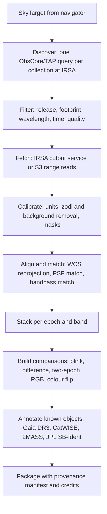

# Image sources and processing pipeline

**Version:** v0.1, draft. Written 2026-11-14 (Europe/Bucharest).
**Purpose:** record which images we use, why we chose them, how we filter them and how we process them. This document is the source material for the project presentation.
**Companion:** [plan-sky-navigator.md](plan-sky-navigator.md), which covers how the user chooses a target.

---

## 1. Principle: one NASA hub

Every image and every reference catalogue in our comparison view comes from **NASA archives**. We access them through **one hub: IRSA, the NASA/IPAC Infrared Science Archive**. Three NASA services complement it:

| Service | Operator | What we use it for |
|---|---|---|
| **IRSA** (hub) | NASA/IPAC (Caltech) | All images, all reference catalogues, sky tiles |
| **NED** | NASA/IPAC | Converting object names to coordinates (galaxies) |
| **NASA Exoplanet Archive** | NASA/IPAC (NExScI) | Exoplanet host-star pins in the navigator |
| **JPL Small-Body Identification API (SB-Ident)** | NASA JPL Solar System Dynamics | Known asteroids and comets in a field at a given time |

**Why centralise?**

- **One protocol set.** IVOA standards everywhere: TAP/ADQL queries, the ObsCore metadata model, SIA image search, server-side cutouts and HiPS sky tiles. One client library covers every mission.
- **Provenance.** Releases are versioned and carry DOIs, so every image we show can be traced to an exact file.
- **Consistency.** Calibrated, documented releases from the mission teams. We never mix in unknown reprocessing.
- **Reliability and performance.** IRSA is CORS-enabled for browsers and mirrors key datasets to AWS (`nasa-irsa-spherex`, `nasa-irsa-wise`, `nasa-irsa-spitzer`) with anonymous access.
- **Legal clarity.** NASA data with published acknowledgement text, so there's no licensing ambiguity.
- **Story.** It is NASA's own record of the same sky across 25 years.

**Verified on 2026-11-14:** IRSA holds every dataset below. That includes Gaia DR3 (`gaia_dr3_source`), which is ESA data served by NASA's archive and is listed by the challenge under NASA resources.

---

## 2. Source selection

### 2.1 Selection criteria

1. **NASA data**, served by a NASA archive.
2. **All-sky coverage.** Users can pick any coordinate, so every core source must cover it.
3. **Wavelength overlap with SPHEREx (0.75–5.0 µm).** This lets us compare like with like.
4. **Adds a time baseline.** Older epochs make motion and variability visible.
5. **Calibrated, documented, versioned releases**, available through standard services at IRSA.

### 2.2 Decision matrix

| Candidate | NASA | All-sky | Inside 0.75–5 µm | Epoch(s) | At IRSA | Decision |
|---|---|---|---|---|---|---|
| SPHEREx Level 2 spectral images (DR1 + QR3) | ✓ | ✓ | ✓ (102 channels) | 2025–2026 | ✓ | **Core: primary science images** |
| SPHEREx DR1 all-sky spectral cube | ✓ | ✓ | ✓ | 2025-04 → 2026-05, combined | ✓ | **Core: fast colour overview** |
| NEOWISE-R single exposures (L1b) | ✓ | ✓ | ✓ (W1 3.4 µm, most of W2 4.6 µm) | Dec 2013 – Aug 2024, about 2 visits a year | ✓ | **Core: recent time baseline** |
| WISE 2010 cryogenic exposures + AllWISE Atlas | ✓ | ✓ | ✓ (W1, W2; W3/W4 are outside) | 2010–2011 | ✓ | **Core: first WISE epoch** |
| 2MASS All-Sky Atlas images | ✓ (NASA/NSF) | ✓ | ✓ (J 1.24, H 1.66, Ks 2.16 µm) | 1997–2001 | ✓ | **Core: oldest epoch** |
| Spitzer IRAC | ✓ | ✗ (partial) | ✓ (3.6, 4.5 µm) | 2003–2020 | ✓ | Optional extra epochs where available |
| unWISE time-resolved coadds (unwise.me, used by WiseView) | Derived from NASA data | ✓ | ✓ | 2010 → | ✗ (hosted at NERSC) | **Not used.** We rebuild epoch stacks from NASA's NEOWISE L1b at IRSA |
| NEOSSat (CSA, via CADC) | ✗ | ✗ (targeted 0.85° fields) | ✗ (optical) | 2013 → | ✗ | **Not core.** Possible later extension for asteroid follow-up |
| GALEX | ✓ | partial | ✗ (ultraviolet) | 2003–2013 | HiPS only | Navigator colour layer only |
| DSS, SDSS, Planck, Herschel, DENIS, MSX | ✗ | — | — | — | — | Excluded (not NASA) |

### 2.3 Chosen image sources: technical detail

| Role | Dataset | Pixel scale | IRSA access (verified) |
|---|---|---|---|
| Primary science | SPHEREx Level 2 spectral images, 2040×2040 MEF (IMAGE, FLAGS, VARIANCE, ZODI, EPSF, WCS-WAVE) | 6.15″ | ObsCore collections `spherex_dr1`, `spherex_qr3`, `spherex_dr1_deep`, `spherex_qr3_deep`. TAP `spherex.plane` ⋈ `spherex.artifact` (columns `time_bounds_lower/upper`, `energy_bounds_lower/upper`, `energy_bandpassname`). Cutouts via `{uri}?center=RA,Decd&size=deg`. S3 `nasa-irsa-spherex/{dr1,qr3}/` |
| Colour overview | SPHEREx DR1 all-sky cube (102 frames) | 12.9″ | ObsCore `spherex_dr1_cube`; HiPS `…/hips/SPHEREx/spherex_allsky_cube` |
| Recent epochs | NEOWISE-R L1b frames, W1/W2 | 2.75″ | ObsCore `neowiser`. Frame metadata `neowiser_p1bs_frm`; image inventory `wise.neowiser_p1bm_frm` |
| First WISE epoch | WISE All-Sky (cryogenic) L1b + AllWISE Atlas | 2.75″ / 1.375″ | ObsCore `wise_allsky`, `wise_3bandcryo`, `wise_2bandcryo`, `wise_allwise`. Atlas inventory `allwise_p3am_cdd` |
| Oldest epoch | 2MASS All-Sky Release Atlas images, J/H/Ks | 1″ | ObsCore `twomass_allsky`; metadata `twomass.allsky_images` (observation date, filter, telescope) |

### 2.4 Reference catalogues (to recognise what is already known)

| Purpose | Catalogue | IRSA table | Use |
|---|---|---|---|
| Known stars, with motion | Gaia DR3 | `gaia_dr3_source` | Propagate positions from J2016.0 to each image epoch |
| Optical ↔ infrared link | Gaia DR3–AllWISE best neighbour | `gaia_dr3_allwise_best_neighbour` | Ready-made cross-match |
| Known infrared sources and motions | CatWISE2020; AllWISE; unWISE catalogue | `catwise_2020`, `allwise_p3as_psd`, `unwise_2019` | IR counterparts; CatWISE proper motions |
| Near-infrared sources, 1997–2001 | 2MASS PSC / XSC | `fp_psc`, `fp_xsc` | Oldest-epoch counterparts |
| Known asteroids in NEOWISE frames | NEOWISE-R known SSO association list | `neowiser_p1ba_mch` | Flag moving objects (read the caution README first) |
| Known asteroids in any field and time | JPL SB-Ident | `https://ssd-api.jpl.nasa.gov/sb_ident.api` | Supports spacecraft observers through a geocentric state vector |
| Every image that caught a given asteroid | IRSA Moving Object Search Tool (MOST) | IRSA application | Covers SPHEREx, WISE/NEOWISE, 2MASS, Spitzer, ZTF |

---

## 3. Filtering: what gets into a comparison

Each filter stage exists for a stated reason. Each stage also records what it removed, so the user can always ask "why isn't image X here?"

| # | Filter | Rule (initial, to be tuned) | Why |
|---|---|---|---|
| 1 | **Release** | SPHEREx DR1 + QR3 only (QR1 retired, QR2 superseded). Final WISE, NEOWISE and 2MASS releases. Record the version per file | Reproducibility; never mix calibrations |
| 2 | **Footprint** | The image polygon must contain the target (`CONTAINS(POINT('ICRS', ra, dec), poly)`), and the target must be at least one cutout half-width from the detector edge | Avoid edge artefacts and partial cutouts |
| 3 | **Wavelength** (SPHEREx) | Compute the wavelength at the target pixel from the spectral WCS. Keep an exposure only if that wavelength falls inside the comparison filter's bandpass (2MASS J/H/Ks, WISE W1/W2), using the official response curves | SPHEREx's filter varies across the detector, so each exposure sees the target at a different wavelength. Compare like with like |
| 4 | **Time grouping** | Group exposures into epochs: SPHEREx survey passes (~6 months), NEOWISE visits (~6-monthly, many frames each), WISE 2010, 2MASS (single epoch). Use `time_bounds_*`, `mjd` and `ordate` | Stack within an epoch for depth; compare across epochs for change |
| 5 | **Quality: SPHEREx** | Mask pixels using the FLAGS bitmask (bit list from Explanatory Supplement Table 16: saturation, bad pixels, `STREAK` satellite trails, `SATELLITE_HALO`, etc.). Reject an exposure if the target pixel is flagged | Artefacts are the main source of false "discoveries" |
| 5 | **Quality: NEOWISE/WISE** | `qual_frame > 0`, `qi_fact > 0`, `saa_sep > 0`, `moon_masked = 0` in the band used (initial cut; check against the NEOWISE Explanatory Supplement) | Removes frames affected by moonlight, South Atlantic Anomaly radiation or poor image quality |
| 6 | **Known objects** | Label (never silently delete): Gaia DR3 stars propagated to each epoch, CatWISE/AllWISE/2MASS counterparts, and SB-Ident asteroids at each exposure time | A discovery is what remains after subtracting the known |
| 7 | **Detectability** | A source counts as appearing or disappearing only if it lies above that epoch's detection limit (from VARIANCE / uncertainty maps) | Absence is not disappearance. Older surveys are shallower |

---

## 4. Process: from coordinate to comparison



| Step | What happens | Tools / services |
|---|---|---|
| 1. Target | Receive a `SkyTarget` (ICRS position, field of view, uncertainty) from the navigator | — |
| 2. Discover | List every image covering the target in each core collection, with time, wavelength and version | IRSA TAP / SIA (`astroquery.ipac.irsa`, `pyvo`) |
| 3. Filter | Apply section 3, stages 1–5 | Metadata only, so it's fast |
| 4. Fetch | Download small cutouts (e.g. 0.1–0.25°) instead of full files (~70 MB per SPHEREx image) | IRSA cutout service; S3 `nasa-irsa-spherex` for bulk |
| 5. Calibrate | Use common units. Subtract SPHEREx's modelled zodiacal light (ZODI layer, not pre-subtracted) and the local background. Apply masks | `astropy`, `photutils` |
| 6. Align | Reproject every cutout onto one tangent-plane grid centred on the target. Use the images' world coordinate systems (WCS), **not** generic computer-vision feature matching | `reproject` |
| 7. Match | Convolve sharper images (2MASS ~1″ pixels, WISE ~6″ PSF) to SPHEREx's PSF (ePSF, version ≥ 7). Build synthetic J/H/Ks/W1/W2 images from SPHEREx channels, weighted by each filter's response curve | `astropy.convolution`, response curves from mission documentation |
| 8. Stack | Inverse-variance weighted, masked stacks per epoch and per band | `numpy`, `astropy` |
| 9. Compare | Blink sequences, difference images, two-epoch colour composites, SPHEREx wavelength flips. Display stretch (asinh) with stored parameters | Our pipeline; GPU shaders in the app |
| 10. Annotate | Overlay known objects at each epoch, with proper motion applied | IRSA TAP (Gaia DR3, CatWISE, 2MASS), JPL SB-Ident |
| 11. Package | Write the provenance manifest (section 5) plus credits | — |
| 12. Serve | **Hackathon:** precompute the curated targets offline in Python and ship static assets with the Next.js app. **Later:** async jobs running next to the data on AWS (us-east-1) | Python scripts, then a job queue |

**Example story this pipeline enables:** one target seen by four NASA missions across 25 years at the same wavelength. 2MASS Ks (~1999) → WISE W1/W2 (2010) → NEOWISE W1/W2 (2014–2024) → SPHEREx synthetic Ks/W1/W2 plus its full spectrum (2025–2026).

---

## 5. Provenance manifest

Every comparison carries its "passport". The structure is below; the values shown are **illustrative**.

```json
{
  "target": { "ra": 0.0, "dec": 0.0, "frame": "ICRS", "fovDeg": 0.25 },
  "inputs": [
    {
      "mission": "SPHEREx", "collection": "spherex_dr1", "release": "DR1",
      "doi": "10.26131/IRSA678", "file": "<IRSA uri>", "version": "<VERSION header>",
      "mjd": [0, 0], "wavelengthUm": 0.0, "detector": "D2", "flagsRejected": 0
    },
    {
      "mission": "NEOWISE", "collection": "neowiser", "band": "W2",
      "file": "<IRSA uri>", "mjd": 0, "qual_frame": 0
    },
    {
      "mission": "2MASS", "collection": "twomass_allsky", "band": "Ks",
      "file": "<IRSA uri>", "ordate": "<date>"
    }
  ],
  "steps": [
    { "name": "zodi_subtract", "params": {} },
    { "name": "reproject", "params": { "pixelScaleArcsec": 6.15 } },
    { "name": "psf_match", "params": { "targetPsf": "SPHEREx ePSF" } },
    { "name": "stack", "params": { "weighting": "inverse-variance" } },
    { "name": "stretch", "params": { "function": "asinh", "min": 0, "max": 0 } }
  ],
  "knownObjects": { "gaia_dr3": 0, "catwise_2020": 0, "sb_ident": 0 },
  "software": { "pipeline": "<git sha>", "astropy": "<version>" },
  "createdAt": "<ISO 8601 UTC>"
}
```

---

## 6. Credits we must display

Use the acknowledgement text that IRSA publishes for each dataset. Don't paraphrase.

| Dataset | Credit |
|---|---|
| SPHEREx | Acknowledgement sentence on the [IRSA SPHEREx page](https://irsa.ipac.caltech.edu/Missions/spherex.html). DOIs: DR1 spectral images `10.26131/IRSA678`, DR1 all-sky cube `10.26131/IRSA679`, QR3 `10.26131/IRSA662` |
| WISE / NEOWISE | [IRSA WISE page](https://irsa.ipac.caltech.edu/Missions/wise.html) |
| 2MASS | [IRSA 2MASS page](https://irsa.ipac.caltech.edu/Missions/2mass.html) |
| IRSA | IRSA's standard archive acknowledgement |
| Gaia DR3 | ESA/Gaia/DPAC credit and citation instructions |
| JPL SB-Ident | NASA JPL Solar System Dynamics |
| NED / NASA Exoplanet Archive | Their published acknowledgements |

---

## 7. Presentation talking points

1. **One NASA hub.** "Every pixel comes from NASA's Infrared Science Archive. One archive, one set of standards, full traceability."
2. **Four missions, 25 years, one sky.** "2MASS (1997–2001), WISE (2010), NEOWISE (2013–2024), SPHEREx (2025–2026)."
3. **Like with like.** "SPHEREx sees 102 colours, so it can imitate the filters of the older missions. We compare the same wavelength across decades."
4. **Subtract the known, keep the unknown.** "Gaia DR3, CatWISE, 2MASS and JPL's asteroid database label everything already catalogued."
5. **Absence is not disappearance.** "We flag change only when the source would have been detectable in both epochs."
6. **Every pixel carries its passport.** "Each comparison ships with a manifest of files, releases, DOIs and processing steps."
7. **What we left out, and why.** "NEOSSat and unWISE are excellent, but targeted or hosted outside NASA. We centralised on NASA for consistency."

---

## 8. Open items to verify

- The exact SPHEREx FLAGS bit list (Explanatory Supplement Table 16; the PDF is over 10 MB, so read it locally).
- NEOWISE frame-quality thresholds, checked against the NEOWISE Explanatory Supplement.
- Official relative spectral response curves for 2MASS J/H/Ks and WISE W1/W2 (from the mission documentation at IRSA).
- Whether SPHEREx headers carry the spacecraft position needed for JPL SB-Ident. If not, use IRSA MOST or a geocentric approximation with a wider search radius.
- What IRSA's unWISE coadd metadata (`unwise.unwise_neo3_images`) offers as a static deep reference.
- Per-epoch depth maps for the detectability filter.
